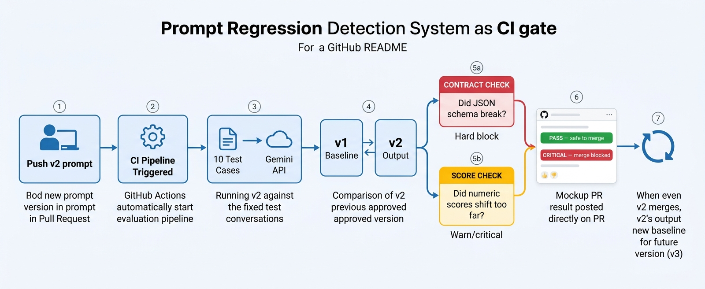

# Prompt Regression Detector

A CI gate for LLM powered features. When someone changes a production prompt, swaps the model, or updates parameters, this system catches quality regressions automatically, before the change reaches users.

---

## Why this exists

AI Engineers often check prompt regressions manually or skip the check entirely. Teams have production logs showing what the current prompt produces, but no way to use those logs as a validation gate for the next version.

So prompt changes ship blind. Someone edits the wording, upgrades the model, or tweaks the temperature. The feature still runs. No errors in the logs. But the outputs are quietly worse and the team finds out from user complaints, days later.

This system is the gate that catches it at PR time.

---

## How it works

1. A developer raises PR for a new prompt version.
2. GitHub Actions runs the new prompt against a Dataset from Production logs.
3. Each output is validated against a strict JSON contract and compared to the previous version's scores.
4. The result — with score tables, violations, and a link to the full report — is posted directly on the PR.
5. If something broke, the merge is blocked.

When the PR merges, the new output becomes the baseline for the next version. v2 is compared against v1. v3 against v2. And so on.

---

## What it catches

**Contract violations** — the model stops following the output schema.
Example: a prompt change causes the model to drop the `objection_handling` field. The system flags it as `MISSING_FIELD` and blocks the merge.

**Score drift** — numeric scores shift after a prompt or model change.
Example: after tightening the rubric, `persuasiveness` drops from 7 to 4 across most cases. The system flags it as WARN or CRITICAL depending on how far the scores moved.

These are different problems with different fixes, and they look different in the report.

---

## The feature under test

The prompt scores a sales conversation on 5 dimensions (1–10 each):

| Dimension | What it measures |
|---|---|
| persuasiveness | Does the salesman make a specific, compelling case? |
| politeness | Courteous and respectful, no pressure tactics? |
| objection_handling | Addresses customer concerns with substance? |
| clarity | Language is precise and carries information? |
| discovery_quality | Asks real questions and uses the answers? |

Plus a `pitch_rating` (poor / bad / average / good / great) and an `overall_score`.

The entire output must be valid JSON matching a strict Pydantic schema. If the model returns `"8"` (string) instead of `8` (integer), that is a contract violation.

---

## Demo

### PR 

### [Full HTML report](https://abhay120204.github.io/Prompt-regression-detector/reports/20261014T111136Z_v2_stricter_gemini-2.5-flash.html)

---

## Tech Stack

| Component | Tool |
|---|---|
| Language | Python 3.10 |
| LLM | Gemini API (model configurable per prompt version) |
| Validation | Pydantic strict mode — 6 violation types, no coercion |
| Report | Jinja2 → single self-contained HTML file |
| CI | GitHub Actions — runs on PRs touching `prompts/` |
| Report hosting | GitHub Pages — clickable link in PR comment |
